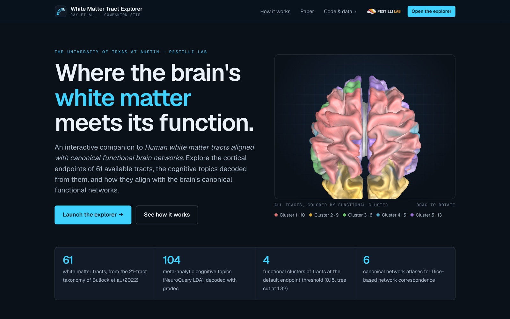
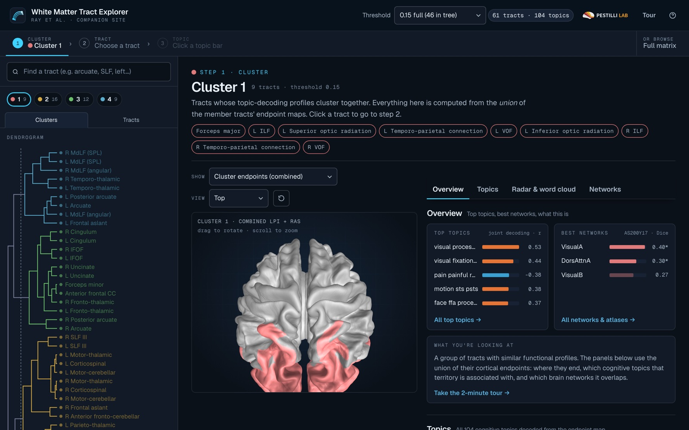
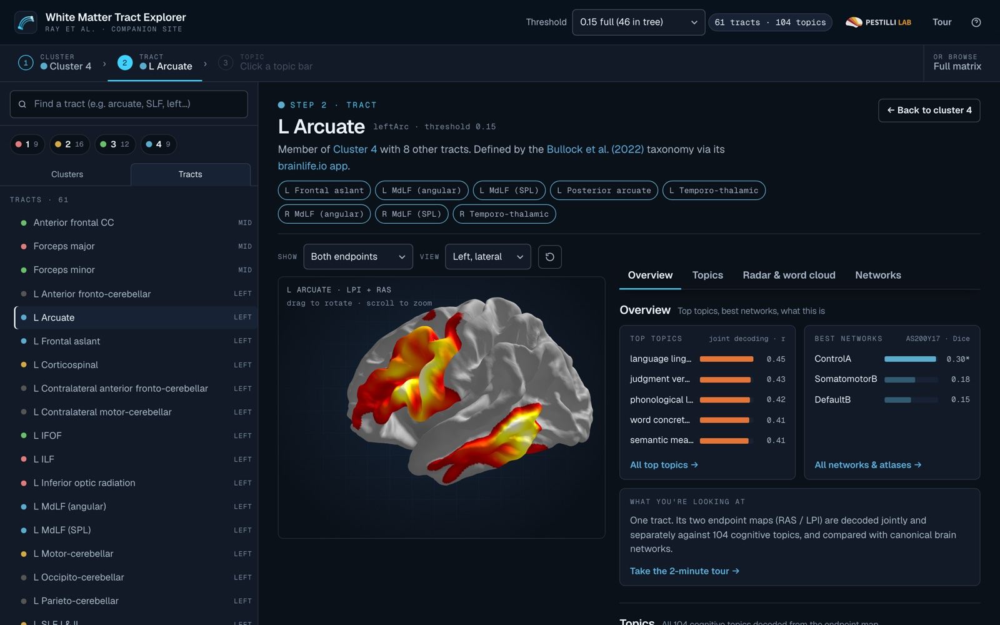
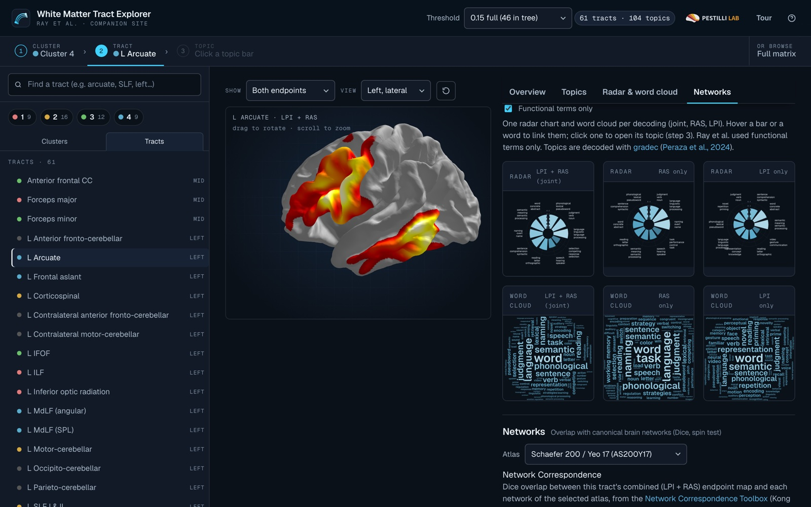
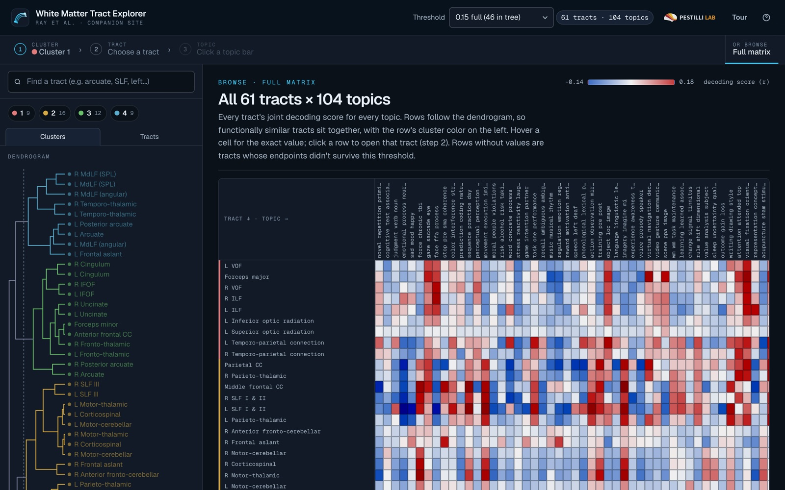

<h1 align="center">White Matter Tract Explorer</h1>

<p align="center">
  <strong>Where the brain's white matter meets its function.</strong><br />
  An interactive companion to <em>Human white matter tracts aligned with canonical functional brain networks</em> (Ray et al.).
</p>

<p align="center">
  <a href="https://connects.brainlife.io/tractsexplorer/"><strong>Open the explorer →</strong></a>
  &nbsp;·&nbsp;
  <a href="docs/guide.md">User guide</a>
  &nbsp;·&nbsp;
  <a href="https://doi.org/10.64898/2026.05.20.726546">Paper</a>
  &nbsp;·&nbsp;
  <a href="server/README.md">JSON API</a>
</p>

<p align="center">
  <a href="https://connects.brainlife.io/tractsexplorer/"></a>
</p>

---

## What it does

White matter tracts are the brain's long-range cables. Each one ends in particular patches of cortex, its **endpoints**. TractsExplorer asks a simple question: *what is the cortex at the ends of each tract known to do?*

For each of **61 tracts** it shows:

- **where the tract ends**: the endpoint density on a 3D cortical surface that you can rotate;
- **what those regions do**: the endpoint map is correlated with **104 cognitive topics** from the meta-analytic literature (NeuroQuery LDA topics, decoded with [gradec](https://gradec.readthedocs.io/en/latest/index.html)), for example "language", "visual fixation" or "pain";
- **which tracts behave alike**: tracts with similar topic profiles are grouped into **functional clusters** with hierarchical clustering;
- **which brain networks they touch**: the Dice overlap between the endpoints and the networks of **6 canonical atlases** (including Yeo 7 and Schaefer 200 / Yeo 17), with spin-test significance.

Everything is computed and drawn live in the browser from the published data. Nothing on screen is a static figure, and every view has its own link that you can share.

<table>
  <tr>
    <td width="50%"><a href="docs/guide.md#step-1--pick-a-cluster"></a><br /><sub><b>Cluster view</b>: the dendrogram, the cluster's combined endpoints, its top topics and its best networks</sub></td>
    <td width="50%"><a href="docs/guide.md#step-2--choose-a-tract"></a><br /><sub><b>Tract view</b>: one tract (here the left arcuate) with its endpoints and decoding</sub></td>
  </tr>
  <tr>
    <td width="50%"><a href="docs/guide.md#step-3--dig-into-a-topic"></a><br /><sub><b>Radar charts and word clouds</b> for the joint, RAS-only and LPI-only decodings</sub></td>
    <td width="50%"><a href="docs/guide.md#full-matrix"></a><br /><sub><b>Full matrix</b>: every tract against every topic, ordered by the dendrogram</sub></td>
  </tr>
</table>

The [**user guide**](docs/guide.md) walks through each view and the methods behind it.

## Ways to use it

| | |
|---|---|
| 🧠 **In the browser** | [connects.brainlife.io/tractsexplorer](https://connects.brainlife.io/tractsexplorer/): a landing page, then the explorer, with a 2-minute guided tour |
| 🔗 **By link** | every view has a URL, e.g. [`explorer.html?tab=tract&tract=leftArc&atlas=AS200Y17`](https://connects.brainlife.io/tractsexplorer/explorer.html?tab=tract&tract=leftArc&atlas=AS200Y17). See the [view links](static/README.md#view-links) |
| 💬 **With SKAI** | ask [SKAI](https://connects.brainlife.io/skai), brainlife's assistant, e.g. *"show me the left arcuate and its Yeo 17 networks"*. It opens the explorer in a side panel and updates it as you talk |
| 🛠️ **Through the API** | a read-only [JSON API](server/README.md) at `https://connects.brainlife.io/api/tractsexplorer/` for clusters, tracts, topics and networks |

## Data

[`data/`](data/) holds the complete published results: decoding matrices, cluster assignments and quality, network correspondence, endpoint maps and figures for each threshold. Its [README](data/README.md) describes the files, how to regenerate them, and how to add a threshold.

Tracts are defined as in [Bullock et al., 2022](https://academic.oup.com/cercor/article/32/20/4524/6528900), using its [brainlife.io app](https://brainlife.io/app/5cc73ef44ed9df00317f6288).

## Running locally

```bash
npm install
npm start          # http://localhost:3000
```

`npm start` links `data/` into `static/` and serves it. Opening the HTML files from disk does not work, because the browser blocks loading the data.

The website and its view links are described in [static/README.md](static/README.md), and the read-only JSON API in [server/README.md](server/README.md).

## Tests

```bash
python3 -m venv server/.venv                                   # once; a venv keeps global pytest plugins out
server/.venv/bin/pip install -r server/requirements-dev.txt   # once
server/.venv/bin/python -m pytest tests/server -W error
npm test
```

On pushes to `main`, GitHub Actions runs the tests and deploys `static/` plus `data/` to GitHub Pages (**Settings → Pages → Source: GitHub Actions**).

## Repository layout

| Path | Contents |
|---|---|
| [`static/`](static/README.md) | the website: landing page and explorer, with no build step |
| [`data/`](data/README.md) | configuration, lookup tables and published data, shared by the website and the API |
| [`server/`](server/README.md) | read-only JSON API |
| [`docs/`](docs/guide.md) | the user guide and its screenshots |
| `scripts/` | offline scripts that build `data/` from the analysis outputs |
| `tests/` | tests for `server/` (`tests/server`) and `static/` (`tests/static`) |

## Credits

Developed by Kim Ray, University of Texas at Austin ([Pestilli Lab](https://pestillilab.github.io/)). Supported by the [brainlife.io](https://brainlife.io) platform.

This tool accompanies:

> Human white matter tracts aligned with canonical functional brain networks
> Kimberly L. Ray, Sohmee Kim, Karen Herrera, Suna Guo, Daniela Reyes, Julio A. Peraza, Anna Bostoganashvili, Gabriele Amorosino, Angela R. Laird, Franco Pestilli
> doi: [10.64898/2026.05.20.726546](https://doi.org/10.64898/2026.05.20.726546)

Topic decoding uses [gradec](https://gradec.readthedocs.io/en/latest/index.html):

> Methods for decoding cortical gradients of function
> Julio A. Peraza, et al., 2024
> doi: [10.1162/imag_a_00081](https://direct.mit.edu/imag/article/doi/10.1162/imag_a_00081/119100/Methods-for-decoding-cortical-gradients-of)
