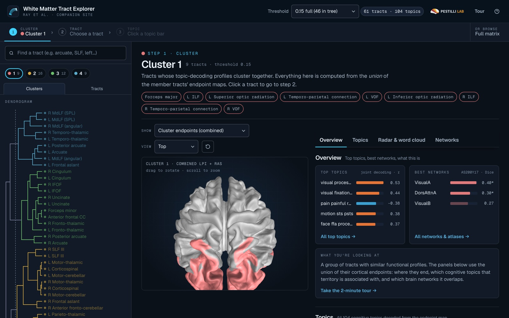
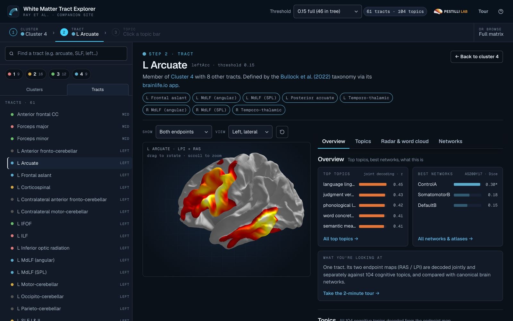
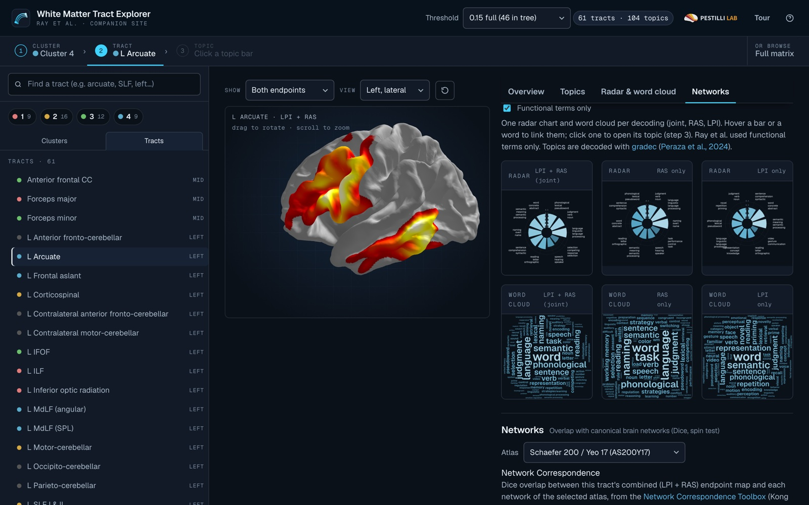
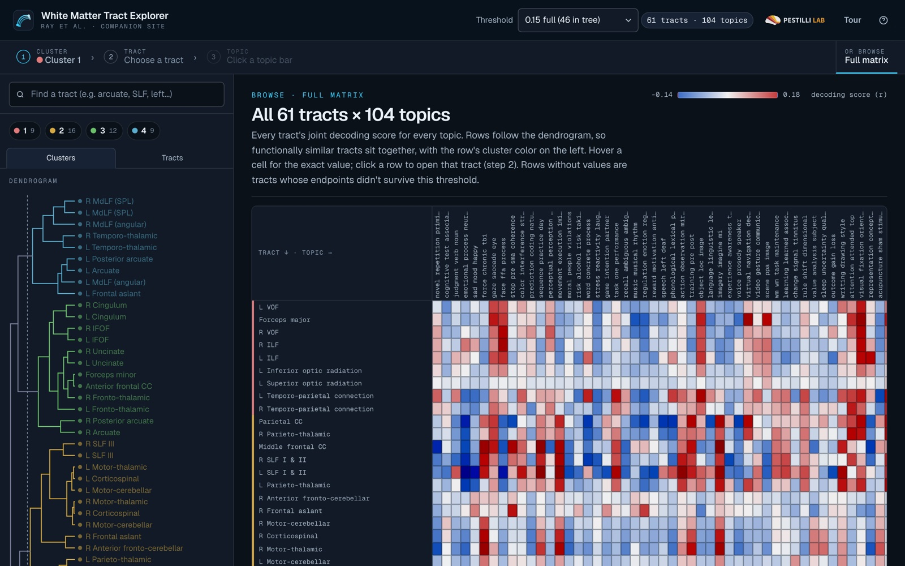

# TractsExplorer user guide

TractsExplorer is the interactive companion to *Human white matter tracts aligned with canonical functional brain networks* (Ray et al., doi: [10.64898/2026.05.20.726546](https://doi.org/10.64898/2026.05.20.726546)). This guide explains what the explorer shows, how to move through it, and how the numbers behind each panel are computed.

**Open it:** [connects.brainlife.io/tractsexplorer](https://connects.brainlife.io/tractsexplorer/)

- [The idea in one paragraph](#the-idea-in-one-paragraph)
- [Key terms](#key-terms)
- [Step 1 · Pick a cluster](#step-1--pick-a-cluster)
- [Step 2 · Choose a tract](#step-2--choose-a-tract)
- [Step 3 · Dig into a topic](#step-3--dig-into-a-topic)
- [Network correspondence](#network-correspondence)
- [Full matrix](#full-matrix)
- [Thresholds](#thresholds)
- [Sharing a view](#sharing-a-view)
- [Using it with SKAI](#using-it-with-skai)
- [Using it from code](#using-it-from-code)
- [How the numbers are made](#how-the-numbers-are-made)

## The idea in one paragraph

A white matter tract connects distant parts of the cortex. If we know where a tract ends, we can ask what those cortical regions do, using decades of brain-imaging studies summarized as meta-analytic maps. TractsExplorer does this for 61 tracts. For each tract, it correlates the cortical endpoint map with 104 cognitive topic maps. It then groups tracts whose functional profiles look alike, and measures how well the endpoints line up with the networks of six canonical functional atlases.

## Key terms

| Term | Meaning |
|---|---|
| **Tract** | A white matter bundle from the 21-tract taxonomy of [Bullock et al., 2022](https://academic.oup.com/cercor/article/32/20/4524/6528900), split by hemisphere where it applies (61 in total), e.g. *L Arcuate* (`leftArc`). |
| **Endpoint map** | Where the tract's streamlines end on the cortex, as a density map on the fsaverage surface. Each tract has two ends, labeled **RAS** and **LPI** after the direction they point; **joint** means both together. |
| **Topic** | One of 104 NeuroQuery LDA topics, each a set of 40 weighted terms (e.g. *language, linguistic, sentence…*) with a meta-analytic brain map. |
| **Decoding score (r)** | The Pearson correlation between an endpoint map and a topic map, computed with [gradec](https://gradec.readthedocs.io/en/latest/index.html) (Peraza et al., 2024). Positive means the tract ends where that topic is active. |
| **Cluster** | A group of tracts with similar decoding profiles, found by hierarchical clustering. |
| **Network correspondence** | The Dice overlap between the endpoints and each network of a functional atlas, with a spin-test p-value. |
| **Threshold** | The endpoint-density cut used to make the maps (0.05–0.20); 0.15 is the paper's default. |

## Step 1 · Pick a cluster



The explorer opens on the **Cluster view**. The left panel holds the **dendrogram**: every tract, ordered so that functionally similar tracts sit next to each other and colored by cluster. The cluster chips above it (e.g. `1 · 9` = cluster 1, 9 tracts) jump to a cluster.

The main panel shows the selected cluster:

- its **member tracts** (click one to go to step 2);
- the **combined endpoint map** of all its members in 3D, or each member in its own color (*Show → coloured by tract*). Drag to rotate, scroll to zoom, or choose a camera angle under *View*;
- **Overview**: the top topics and the best-matching networks at a glance;
- tabs for the full **Topics** list, **Radar & word cloud** and **Networks**.

## Step 2 · Choose a tract



Click a tract in the dendrogram, in the **Tracts** list or in a cluster's member chips, or type in the search box (`arcuate`, `SLF`, `left…`). The **Tract view** shows:

- the tract's cluster and its sibling tracts, with *Back to cluster* to return;
- the 3D endpoint map. *Show* switches between **both endpoints**, **RAS only** and **LPI only**, and the *Left, medial* and *Right, medial* views show one hemisphere on its own;
- the top topics and best networks, as in the cluster view.

## Step 3 · Dig into a topic



The **Topics** tab ranks all 104 topics by decoding score for the joint, RAS-only and LPI-only maps side by side. Click any topic bar to open its details: the full 40-term list with LDA weights and term types.

**Radar & word cloud** regenerates the paper's figures live for the current tract or cluster: one radar chart and one word cloud per decoding. Hover a bar or a word to link them, and click one to open that topic. *Functional terms only* (on by default, as in the paper) hides anatomical and methodological terms.

## Network correspondence

The **Networks** tab compares the endpoint map with six canonical atlases:

| Code | Atlas |
|---|---|
| `TY7` | Yeo 7 networks |
| `AS200Y17` | Schaefer 200 parcels / Yeo 17 networks |
| `EG17` | Gordon 17 networks |
| `EG286_12` | Gordon 286 parcels / 12 networks |
| `MG360J12` | Glasser 360 parcels / 12 networks (Ji) |
| `XS268_8` | Shen 268 parcels / 8 networks |

For each network it shows the **Dice overlap**, whether the overlap is significant under a **spin test** (marked `*`, p ≤ 0.05), and the largest Dice the two map sizes would allow. Pick the atlas from the menu. **Show networks on the brain** paints the atlas on the cortex under the endpoint map; hover a network's row to find it, and click to isolate it. The values come from the [Network Correspondence Toolbox](https://github.com/rubykong/cbig_network_correspondence) (Kong et al., 2025).

## Full matrix



**Full matrix** (top right) shows every tract against every topic as one heatmap of joint decoding scores, red for positive and blue for negative. The rows follow the dendrogram, with each row's cluster color on its left edge. Hover a cell for its exact value, and click a row to open that tract. Empty rows are tracts whose endpoints did not survive the current threshold.

## Thresholds

The **Threshold** menu in the header switches between the endpoint-density thresholds used in the paper (0.05, 0.10, 0.15, 0.20), plus 0.15 on a fixed 43-tract cohort that gives 5 clusters. Each threshold has its own maps, decodings and clustering, so you can see how stable a result is. The menu also shows how many tracts enter the clustering at that threshold.

## Sharing a view

The address bar always describes what is on screen, so a copied link reopens the same view:

```
https://connects.brainlife.io/tractsexplorer/explorer.html?thr=0.15&tab=tract&tract=leftArc&atlas=AS200Y17
```

Every parameter (threshold, tab, cluster, tract, topic, section, endpoint map, hemisphere, camera, atlas) is listed under [view links](../static/README.md#view-links).

The **Tour** button in the header starts a 2-minute guided walkthrough of every panel, and **?** opens a short help sheet.

## Using it with SKAI

[SKAI](https://connects.brainlife.io/skai), brainlife's assistant, can drive the explorer for you. Ask in plain language, for example:

- *"Which tracts are most associated with language?"*
- *"Show me the left arcuate."*
- *"Now its overlap with the Yeo 7 networks."*
- *"Switch to threshold 0.20 and open cluster 3."*

SKAI looks up the answer through the API and opens the explorer in a side panel next to the chat. As the conversation continues, it moves that same panel to the new view without reloading the 3D brain. You can also click around in the panel yourself.

## Using it from code

A read-only JSON API serves the same results:

```bash
curl https://connects.brainlife.io/api/tractsexplorer/thresholds
curl https://connects.brainlife.io/api/tractsexplorer/default/tracts/leftArc?atlas=TY7
curl "https://connects.brainlife.io/api/tractsexplorer/topics?q=language"
```

Cluster and tract results include a `view_url` that opens the matching explorer view. All endpoints are listed in [server/README.md](../server/README.md).

## How the numbers are made

1. **Tracts and endpoints.** Tracts are segmented with the [Bullock et al. (2022) brainlife.io app](https://brainlife.io/app/5cc73ef44ed9df00317f6288). Their streamline endpoints are projected to the cortical surface, smoothed, and cut at each density threshold. This gives one RAS and one LPI map per tract on fsaverage.
2. **Decoding.** Each map (joint, RAS, LPI) is correlated with the 104 NeuroQuery LDA topic maps using gradec, which gives a tract × topic matrix of Pearson r.
3. **Clustering.** For tracts with complete scores, the distance between two tracts is 1 − r between their joint topic profiles. The tracts are clustered with complete linkage and the tree is cut at 1.32. This runs live in the browser and reproduces the paper's analysis.
4. **Network correspondence.** Joint endpoint maps are mapped to fsaverage6 and compared with each atlas network by Dice overlap. Significance comes from spin-test permutations.

The data files and the scripts that build them are described in [data/README.md](../data/README.md).
